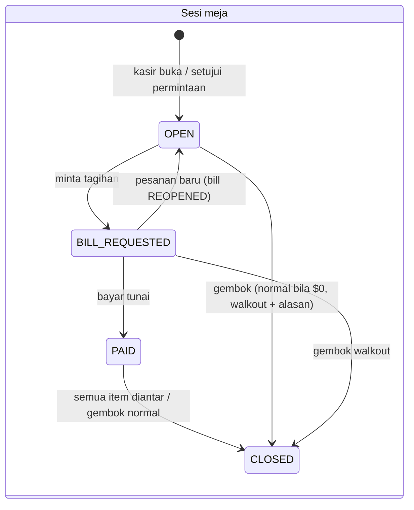
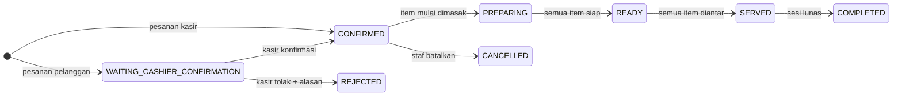
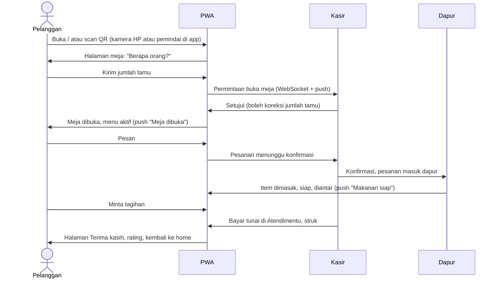

# PRODUCT REQUIREMENTS DOCUMENT (PRD)
# Celvass Resto & Bar PWA
## Sistem Pemesanan Restoran & Bar Berbasis Progressive Web Application dengan Verifikasi Kasir

| | |
|---|---|
| **Document ID** | PRD-RESTO-PWA-001 |
| **Versi** | 3.0.0 (disusun ulang mengikuti sistem yang berjalan) |
| **Tanggal** | 2026-11-26 |
| **Restoran** | Celvass Resto & Bar, Praia dos Coqueiros, Dili, Timor-Leste |
| **Bahasa UI** | Tetun (default), Português, English, Bahasa Indonesia |
| **Mata uang** | USD ($), pembayaran tunai |
| **Stack** | Django 5.2, Django REST Framework 3.18, Channels 4.3 + Daphne, PostgreSQL (produksi) / SQLite (lokal), PWA vanilla JS |
| **Repositori** | `sagedral02/Sistema-Pedidu-Hahan-Bazeia-ba-PWA-ba-Celvass-Resto-Bar` |

Dokumen ini menggantikan PRD v2.1.0. Isinya menggambarkan **perilaku sistem yang sudah dibangun dan diuji**, bukan rencana awal. Setiap aturan di sini punya padanan di kode (`apps/`) dan sebagian besar punya test di `tests/`.

---

## 1. Ringkasan produk

Celvass PWA adalah aplikasi web yang bisa di-install (PWA) untuk restoran dine-in dan take away. Ada empat pengguna:

- **Pelanggan** membuka halaman utama untuk melihat menu dan info restoran, lalu scan QR di meja untuk memesan dari HP sendiri tanpa akun.
- **Kasir** membuka meja, memverifikasi pesanan pelanggan sebelum masuk dapur, membuat pesanan sendiri (meja atau take away), meminta tagihan, menerima pembayaran tunai, dan menutup shift.
- **Dapur** melihat antrean per item, mengubah status item (masak, siap, diantar), dan melaporkan menu habis.
- **Admin** mengelola menu, kuota harian, meja, staf, konfigurasi restoran, serta melihat Overview, laporan, riwayat, dan audit.

Prinsip utama:

1. Pesanan pelanggan **tidak masuk dapur** sebelum dikonfirmasi kasir.
2. Harga dan total **selalu dihitung server**, tidak pernah dari browser.
3. Satu meja hanya punya **satu sesi aktif**, dan sesi itu terkunci ke HP yang pertama memakainya.
4. Setiap perubahan uang dan status penting tercatat di **audit log**.

---

## 2. Latar belakang dan tujuan

Masalah yang diselesaikan:

- Pesanan manual lambat dan sering salah catat.
- Pesanan palsu dari orang yang tidak duduk di meja.
- Kasir tidak tahu status masakan per item.
- Meja yang ditinggal tamu tanpa bayar tetap terlihat "terisi" dan kerugiannya tidak tercatat.
- Pemilik tidak punya data penjualan, pengunjung, dan menu terlaris.

Tujuan (konteks skripsi):

1. Membangun PWA pemesanan dine-in berbasis Django yang tidak wajib di-install.
2. Menerapkan gerbang verifikasi kasir sebelum pesanan diproses dapur.
3. Mencegah pesanan ganda (idempotency) dan membatasi spam (batas pesanan menunggu, device lock).
4. Menjaga konsistensi status saat pelanggan, kasir, dan dapur bekerja bersamaan (transaksi atomik, row lock, outbox).
5. Menyediakan laporan yang angkanya sama di layar, CSV, dan PDF.

Judul skripsi yang direkomendasikan: **Rancang Bangun Sistem Pemesanan Makanan Berbasis Progressive Web Application (PWA) dengan Mekanisme Verifikasi Pesanan oleh Kasir pada Celvass Resto & Bar.** Klaim yang dipakai adalah "mengurangi risiko pesanan tidak terverifikasi", bukan "menghilangkan fake order".

---

## 3. Ruang lingkup

**Termasuk:**

- Dine-in lewat QR meja.
- Take away dari kasir, dengan nomor antrean harian.
- Status per item di dapur, kuota harian, dan "tutup menu hari ini".
- Tagihan (bill), pembayaran tunai, shift kasir, dan struk.
- Rating menu dan highlight katalog.
- Konfigurasi restoran (logo yang juga dipakai sebagai ikon PWA, kontak, Google Maps, jam buka).
- Overview, 9 laporan, riwayat pesanan dan transaksi, audit log, ekspor CSV/PDF.
- Notifikasi realtime (WebSocket), suara, dan Web Push.
- Pemindai QR di dalam aplikasi.

**Tidak termasuk:**

- Delivery.
- Pembayaran online (kartu atau e-wallet) dan split bill otomatis.
- Program loyalti dan akun pelanggan.
- Multi-cabang (sistem memakai satu `Restaurant`).

---

## 4. Aktor dan hak akses

| Aktor | Login | Portal | Hak utama |
|---|---|---|---|
| Pelanggan | Tidak | `/`, `/t/<qr>/` | Lihat menu, minta buka meja (isi jumlah tamu), pesan, lacak pesanan, minta tagihan, beri rating setelah bayar, aktifkan notifikasi |
| Kasir (`CASHIER`) | Ya | `/cashier/` | Buka/tutup meja, verifikasi atau tolak pesanan, pesan untuk meja atau take away, minta tagihan, terima pembayaran, tutup menu hari ini, shift, laporan miliknya |
| Dapur (`KITCHEN`) | Ya | `/kitchen/` | Antrean per item, ubah status item, laporkan menu habis |
| Admin (`ADMIN`) | Ya | `/admin-portal/`, `/reports/` | Semua di atas ditambah CRUD menu/kategori/meja/staf, kuota, konfigurasi, Overview, semua laporan, audit |

Kontrol akses diterapkan di server lewat `role_required` (halaman) dan permission DRF (`IsCashierRole`, `IsKitchenRole`, `IsAdminRole`, …). Role kasir hanya melihat data miliknya di laporan yang bersifat pribadi (shift, pengecualian, transaksi).

---

## 5. Menu per portal

**Pelanggan**

- **Home (`/`)** menampilkan:
  - Logo, nama, dan deskripsi restoran.
  - Status buka/tutup saat ini dan jam hari ini.
  - Tombol **Scan QR meja**.
  - Menu read-only: kategori bisa digeser ke samping, ada pencarian dan highlight.
  - Kontak (WhatsApp, telepon, email, website, Instagram, Facebook), peta Google Maps, dan jam buka seminggu.
- **Halaman meja (`/t/<qr>/`)** berisi:
  - Langkah "berapa orang?" untuk meminta buka meja.
  - Katalog dengan keranjang.
  - Daftar pesanan aktif dan tombol minta tagihan.
  - Tombol aktifkan notifikasi.
- **Pelacak pesanan (`/t/<qr>/order/<kode>/`)** menampilkan status pesanan dan status tiap item.
- **Terima kasih (`/t/<qr>/thanks/<token>/`)** berisi ringkasan, rating per hidangan, dan hitung mundur 25 detik ke `CUSTOMER_HOME_URL`.
- **Meja terisi (403)** muncul untuk HP lain:
  - Pesan bahwa meja sedang dipakai.
  - Tombol **Scan QR meja lain**, **Hubungi kasir**, dan **Lihat menu**.
  - Staf yang login diberi tautan ke POS.

**Kasir** punya 5 menu di tabbar HP dan top nav:

1. **POS**, dengan tiga tampilan:
   - Antrean: permintaan buka meja dan pesanan menunggu.
   - Meja: kartu meja bisa di-expand untuk melihat isi pesanan dan status tiap item.
   - Take away.
2. **Atendimentu**, dengan tiga tab:
   - Konta (semua tagihan yang diminta; pembayaran hanya di sini).
   - Info dapur.
   - Meja tidak aktif.
3. **Menu & Stok**: tutup hari ini atau buka lagi.
4. **Turnu (shift)**: kas awal, penjualan tunai, kas yang diharapkan, kas yang dihitung, selisih.
5. **Laporan**.

**Dapur:** antrean per item dalam tiga kolom (antre, masak, siap) dan laporan menu habis.

**Admin** punya 6 menu:

1. **Overview** (Rezumu): KPI dan grafik.
2. **Katálogu**: tab Menu & Stok (CRUD menu, kuota inline, kolom rating, ulasan terbaru) dan tab Kategori.
3. **Meja & QR**: CRUD, kapasitas, rotasi QR, cetak lembar QR.
4. **Staff**.
5. **Konfigurasi** (juga bisa dibuka dari menu akun).
6. **Laporan**: ringkasan, riwayat, audit.

---

## 6. Istilah

| Istilah | Arti |
|---|---|
| **Meja** (`RestaurantTable`) | Meja fisik dengan `qr_token` acak, `capacity`, dan status `AVAILABLE` / `OCCUPIED` / `MAINTENANCE`. Take away memakai satu meja virtual `is_takeaway=True`. |
| **Sesi meja** (`TableSession`) | Pemakaian meja dari dibuka sampai ditutup. Menyimpan `guest_count`, device pemilik, `close_kind` (`NORMAL`/`WALKOUT`), dan `unpaid_amount`. |
| **Permintaan buka meja** (`TableActivationRequest`) | Permintaan dari HP pelanggan yang berisi jumlah tamu. Disetujui atau ditolak kasir. |
| **Pesanan** (`Order`) | Satu kiriman berisi beberapa item. Satu sesi bisa punya banyak pesanan. |
| **Item pesanan** (`OrderItem`) | Snapshot nama dan harga menu, beserta status dapur per baris. |
| **Tagihan** (`Bill`) | Dibuat saat tagihan diminta. Status: `REQUESTED`, `REOPENED`, `PAID`, `WALKOUT`. |
| **Pembayaran** (`Payment`) | Pembayaran tunai terhadap tagihan (uang diterima, kembalian). Status: `PENDING`, `COMPLETED`, `VOIDED`. |
| **Shift** | Sesi kerja kasir dengan kas awal. Pembayaran wajib di dalam shift terbuka. |
| **Walkout** | Sesi ditutup karena tamu pergi tanpa bayar. Sisa tagihan dicatat sebagai kerugian. |
| **Outbox** | Event yang disimpan dalam transaksi yang sama, lalu dikirim ke WebSocket dan Web Push setelah commit. |

---

## 7. Aturan bisnis

### 7.1 Meja dan sesi
- **BR-01** Satu meja hanya punya satu sesi aktif (`OPEN`, `BILL_REQUESTED`, `PAYMENT_PENDING`, `PAID`).
- **BR-02 Jumlah tamu harus antara 1 dan `guest_limit` meja.** `guest_limit` adalah kapasitas yang diatur admin, atau 25 bila kosong. Aturan ini berlaku untuk permintaan dari QR, buka sesi oleh kasir, dan koreksi saat menyetujui. Take away tidak memakai jumlah tamu.
- **BR-03 Device lock.** Sesi terkunci ke HP pertama yang memakainya, lewat cookie httpOnly `celvass_device_id`.
  - HP lain, termasuk staf yang login, mendapat halaman **Meja terisi** (403), tanpa skrip polling.
  - Staf yang membuka sesi yang belum diklaim hanya melihat pratinjau dan tidak mengklaimnya.
- **BR-04 Halaman meja tidak boleh reload berulang.** Reload otomatis paling banyak sekali per 15 detik (`safeReload`). Bila terkunci, halaman menampilkan pemberitahuan, bukan reload.
- **BR-05 Pelanggan harus mengisi jumlah tamu** sebelum meminta buka meja. Tidak ada permintaan otomatis saat halaman dibuka.
- **BR-06 Setelah sesi dibayar dan ditutup**, HP pemilik diarahkan ke halaman Terima kasih (berlaku 6 jam). HP itu tidak membuat permintaan baru secara otomatis; tersedia tombol "Mulai pesanan baru".

### 7.2 Jam buka
- **BR-07** Admin mengatur jam buka per hari, termasuk jam yang melewati tengah malam. Bila tidak ada jam yang diatur, restoran dianggap selalu buka.
- **BR-08** Di luar jam buka, permintaan buka meja dan pesanan dari pelanggan ditolak dengan `409 RESTAURANT_CLOSED`. **Kasir tetap bisa** membuka meja dan memesan.

### 7.3 Pesanan
- **BR-09 Pesanan pelanggan masuk sebagai `WAITING_CASHIER_CONFIRMATION`.** Dapur hanya melihatnya setelah kasir mengonfirmasi (`CONFIRMED`). Penolakan wajib disertai alasan.
- **BR-10 Pesanan kasir langsung `CONFIRMED`.** Untuk meja, sesi harus sudah dibuka. Pesanan ke meja tanpa sesi OPEN/BILL_REQUESTED ditolak dengan `409 TABLE_SESSION_NOT_OPEN`, karena pesanan tidak pernah membuka meja.
- **BR-11** Satu sesi hanya boleh punya satu pesanan pelanggan yang masih menunggu kasir.
- **BR-12 Idempotency.** Pengiriman ulang dengan kunci yang sama (`Idempotency-Key`) mengembalikan pesanan yang sama, tanpa membuat duplikat.
- **BR-13** Harga, pajak, dan total dihitung server dari data menu.

### 7.4 Dapur, kuota, dan ketersediaan
- **BR-14 Status per item:** `QUEUED → COOKING → READY → SERVED`, atau `UNAVAILABLE` (habis, wajib dengan alasan). Status pesanan diturunkan dari status item-itemnya.
- **BR-15** Item `UNAVAILABLE` tidak ditagih, tidak dicetak di struk, dan memunculkan **Info dapur** untuk kasir.
- **BR-16** **Kuota harian** per menu (kosong berarti tanpa batas). "Terjual" dihitung dari item pesanan hari bisnis itu, tidak termasuk item yang ditolak, dibatalkan, atau habis.
  - Bila kuota tercapai, status menjadi `QUOTA_REACHED`.
  - Admin bisa mengubah kuota langsung di tabel.
- **BR-17 Tutup hari ini.** Kasir atau admin bisa menutup menu untuk hari bisnis berjalan. Porsi yang belum dimasak dibatalkan.
- **BR-18** Hari bisnis dimulai pada `BUSINESS_DAY_START_HOUR` (default 00:00, zona Asia/Dili).

### 7.5 Tagihan dan pembayaran
- **BR-19 Minta tagihan.**
  - Pelanggan baru bisa meminta tagihan setelah semua item diantar.
  - Kasir bisa memaksa (`force`) setelah melihat daftar item yang belum diantar.
- **BR-20 Kartu meja kasir mengikuti alur berikut:**

  | State | Tombol utama | Tambahan |
  |---|---|---|
  | Kosong | Loke sesaun | QR |
  | Permintaan masuk | Aprova (bisa koreksi jumlah tamu) | QR |
  | Aktif / masih dimasak | Pedidu | QR, gembok |
  | Semua diantar | Request bill | **+** pesan lagi, QR, gembok |
  | Tagihan diminta | "Konta husu ona" (nonaktif, bayar di Atendimentu) | **+**, QR, gembok |
  | Lunas, menunggu item diantar | Struk | gembok |

- **BR-21** Pesanan baru pada sesi `BILL_REQUESTED` membuka ulang tagihan (`REOPENED`). Tagihan perlu diminta lagi.
- **BR-22 Hanya tunai.**
  - Uang diterima harus ≥ sisa tagihan, dan kembalian dihitung server.
  - Pembayaran wajib dalam **shift terbuka** (`REQUIRE_SHIFT_FOR_PAYMENT`).
- **BR-23** Sesi dine-in yang lunas dan semua itemnya sudah diantar langsung ditutup otomatis. Take away ditutup saat makanan diserahkan (`hand-over`).
- **BR-24 Shift** tidak bisa ditutup bila masih ada tagihan `REQUESTED` yang diminta kasir itu. Selisih kas wajib diberi catatan.

### 7.6 Menutup meja (gembok) dan tamu yang kabur
- **BR-25 Tutup normal** hanya bisa bila sisa tagihan $0 (lunas, atau belum ada yang ditagih). Selain itu ditolak dengan `409 SESSION_UNPAID`.
- **BR-26 Tamu pergi tanpa bayar** (walkout):
  - Wajib diisi alasan minimal 3 karakter.
  - Pesanan yang masih menunggu kasir dibatalkan.
  - Tagihan yang terbuka menjadi `WALKOUT`, sehingga shift tetap bisa ditutup.
  - Sisa tagihan disimpan di `unpaid_amount`.
  - Audit `TABLE_WALKOUT` dicatat dan meja kembali `AVAILABLE`.
  - Kasir maupun admin boleh melakukannya.
- **BR-27** Walkout tampil di laporan **Rekuza, kansela no anula** (baris "Sai la selu", ringkasan jumlah dan nominal) dan di KPI Overview **La selu**.

### 7.7 Meja tidak aktif
- **BR-28** Sebuah meja dianggap **tidak aktif** bila semua syarat ini terpenuhi:
  - Sesi belum lunas (`OPEN`/`BILL_REQUESTED`/`PAYMENT_PENDING`).
  - Tidak ada item yang menunggu, dimasak, atau siap.
  - Tidak ada aktivitas selama `idle_alert_minutes` (Konfigurasi admin, default 45, 0 = mati).

  Aktivitas yang dihitung: sesi dibuka, pesanan dibuat atau diubah, perubahan status item, tagihan diminta, pembayaran.
- **BR-29** Meja tidak aktif ditandai di kartu meja dan muncul di tab **Atendimentu → Meja tidak aktif** (dengan badge jumlah, bunyi, dan toast). Push ke kasir dikirim **sekali per sesi** (`idle_alerted_at`). Perintah `check_idle_tables` bisa dijalankan lewat cron agar alert tetap terkirim walau tidak ada layar kasir yang terbuka.

### 7.8 Rating dan highlight
- **BR-30** Rating 1–5 per hidangan hanya bisa diberikan dari halaman Terima kasih oleh HP pemilik, dalam 6 jam setelah sesi selesai. Hanya hidangan yang benar-benar diterima yang bisa dinilai. Kirim ulang akan memperbarui rating. Batas 30 kiriman per sesi.
- **BR-31 Highlight katalog:**
  - **Rating tertinggi**: minimal 3 ulasan.
  - **Paling banyak dipesan**: 30 hari terakhir, tanpa item habis dan tanpa pesanan ditolak, dibatalkan, atau draft.
  - **Rekomendasi**: `is_featured`.

  Ketiganya tersedia untuk semua menu dan per kategori.

### 7.9 Laporan
- **BR-32 Definisi angka:**
  - **Penjualan** = `Payment` `COMPLETED` menurut `paid_at`.
  - **Item terjual** = item pesanan `CONFIRMED`..`COMPLETED` menurut tanggal pesanan.
  - **Pengunjung** = jumlah `guest_count` sesi dine-in yang dibuka dalam periode, tanpa sesi `CANCELLED` dan tanpa take away.
- **BR-33** Layar, CSV (UTF-8 BOM, aman dari formula injection), dan PDF memakai struktur `ReportData` yang sama, sehingga angkanya tidak bisa berbeda.

---

## 8. State machine





| Objek | Status |
|---|---|
| Meja | `AVAILABLE`, `OCCUPIED`, `MAINTENANCE` (`CLEANING` tersedia di model) |
| Item pesanan | `QUEUED`, `COOKING`, `READY`, `SERVED`, `UNAVAILABLE` |
| Tagihan | `REQUESTED`, `REOPENED`, `PAID`, `WALKOUT` |
| Pembayaran | `PENDING`, `COMPLETED`, `VOIDED` |
| Permintaan buka meja | `PENDING`, `APPROVED`, `REJECTED`, `CANCELLED` |
| Shift | `OPEN`, `CLOSED` |

Semua transisi dijalankan di service layer dalam `transaction.atomic()` dengan `select_for_update()`, dan dicatat di audit atau riwayat status.

---

## 9. Alur utama

### 9.1 Pelanggan dine-in



### 9.2 Kasir membuka meja dan memesan
1. Kartu meja kosong, lalu **Loke sesaun** (jumlah tamu dibatasi kapasitas).
2. Tombol berubah menjadi **Pedidu**. Popup pesanan berisi daftar menu satu kolom yang di-scroll ke bawah. Hanya baris kategori yang bisa digeser ke samping.
3. Kasir bisa membuka **Detail** di kartu untuk melihat status tiap item.
4. Setelah semua item diantar, tombol berubah menjadi **Request bill**, dengan tombol **+** untuk pesanan tambahan.
5. Setelah tagihan diminta, tombol menjadi nonaktif. Pembayaran dilakukan di **Atendimentu → Konta**.
6. Setelah lunas dan semua item diantar, sesi tertutup otomatis. Kalau tamu kabur, gunakan **gembok → Tamu pergi tanpa bayar**.

### 9.3 Take away
Kasir membuat pesanan take away dengan nama opsional. Pesanan mendapat nomor antrean harian (`Take away #001 - Budi`) dan masuk dapur. Saat siap, kasir mendapat notifikasi. Alurnya: minta tagihan, bayar, lalu **Serahkan** (hand-over), dan sesi ditutup.

### 9.4 Dapur
Item tampil di kolom antre, masak, dan siap. Dapur bisa memproses per item atau per pesanan. **Habis** wajib diberi alasan dan mengirim Info dapur ke kasir.

---

## 10. Konfigurasi restoran (Admin → Konfigurasi)

| Bagian | Isi |
|---|---|
| Identitas | Nama, nama pendek (label ikon di HP), nama legal, deskripsi, **logo** (PNG/JPG). Logo otomatis dibuat menjadi ikon PWA (192, 512, maskable, apple-touch, favicon) dan disimpan di database (`RestaurantIcon`), karena disk Vercel read-only. |
| Kontak | Telepon, WhatsApp, email, website, Instagram, Facebook, alamat |
| Lokasi | Link Google Maps atau koordinat, dengan pratinjau peta |
| Jam buka | Per hari: tutup, atau jam buka dan tutup |
| Operasional | Pajak (%), catatan struk, **batas meja tidak aktif (menit)** |

Ikon default (garpu dan pisau) dibuat dengan `manage.py generate_brand_icons`. Setiap perubahan konfigurasi dicatat di audit `RESTAURANT_SETTINGS_UPDATE`.

---

## 11. Notifikasi

| Saluran | Kapan dipakai |
|---|---|
| **WebSocket** (`/ws/...`, Channels) | Layar yang sedang terbuka: antrean kasir, papan dapur, halaman meja/pelacak pelanggan. Polling 4–10 detik menjadi cadangan. |
| **Suara** | Pesanan atau permintaan baru, tagihan diminta, meja tidak aktif |
| **Web Push** (VAPID, tanpa layanan pihak ketiga) | HP atau browser yang aplikasinya tertutup |

Tabel event Web Push:

| Event | Penerima | Pesan |
|---|---|---|
| `TABLE_ACTIVATION_REQUESTED` | Kasir | Permintaan buka meja |
| `ORDER_CREATED` (menunggu) | Kasir | Pesanan baru menunggu konfirmasi |
| `ORDER_CONFIRMED` | Dapur, tamu meja | Pesanan untuk dapur / pesanan dikonfirmasi |
| `ORDER_REJECTED` | Tamu meja | Pesanan ditolak |
| `ITEM_STATUS_CHANGED` → `READY` | Tamu meja | Makanan siap |
| `BILL_REQUESTED` | Kasir, tamu meja | Tagihan diminta / tagihan siap |
| `PAYMENT_COMPLETED` | Tamu meja | Terima kasih |
| `KITCHEN_NOTICE` | Kasir | Menu tidak tersedia |
| `SESSION_OPENED` | HP yang meminta | Meja dibuka |
| Meja tidak aktif | Kasir | Sekali per sesi |

Aturan Web Push:

- Izin hanya diminta saat tombol **Aktifkan notifikasi** ditekan. Untuk staf tombolnya ada di menu akun, untuk pelanggan di halaman meja.
- Pesan dikirim dalam bahasa yang tersimpan di subscription.
- Langganan pelanggan:
  - Terikat ke QR dan device selama permintaan menunggu.
  - Pindah ke sesi saat meja dibuka.
  - Dihapus saat sesi ditutup.
- Langganan yang kedaluwarsa (404/410) dihapus otomatis.
- Pengiriman berjalan setelah commit, di thread terpisah (`PUSH_ASYNC`). Kegagalan tidak pernah menggagalkan transaksi.
- Tanpa kunci VAPID, fitur push mati.
- Di iPhone, push hanya berjalan bila PWA sudah ditambahkan ke Home Screen (iOS 16.4+).

---

## 12. Overview dan laporan

**Overview (admin)** punya rentang hari ini, 7 hari, atau 30 hari, dengan perbandingan terhadap periode sebelumnya.

- **KPI:** penjualan, transaksi, rata-rata transaksi, pesanan, tingkat penolakan, **pengunjung**, **tidak terbayar (walkout)**, meja terisi.
- **Grafik:** tren penjualan, tipe pesanan, jam sibuk, status pesanan, pengunjung, menu terlaris (jumlah atau pendapatan), penjualan per kategori, per kasir, pembayaran dan penolakan terbaru.
- Setiap elemen bisa diklik untuk membuka laporan atau riwayat terkait.

**Laporan (`/reports/`)** punya preset hari ini, 7 hari, bulan ini, atau custom (maksimal 366 hari):

| Tipe | Isi |
|---|---|
| `daily_sales` | Penjualan per hari |
| `menu_sales` | Penjualan per menu |
| `order_types` | Dine-in vs take away |
| `cashiers` | Per kasir |
| `exceptions` | Ditolak, dibatalkan, void, habis, **walkout** |
| `table_usage` | Pemakaian meja |
| `shifts` | Shift kasir |
| `visitors` | Sesi, tamu, rata-rata tamu per sesi, pesanan take away per hari |
| Audit (admin) | Audit log dengan filter, bisa diekspor CSV/PDF |

Tab **Riwayat** berisi pesanan dan transaksi, dengan filter, detail, cetak ulang struk, dan ekspor. Setiap baris laporan bisa di-drill-down ke riwayat.

---

## 13. Arsitektur

```text
Browser / PWA (vanilla JS, Bootstrap 5, service worker)
        │  HTTPS (REST JSON)            │  WSS (Channels)
        ▼                               ▼
Django 5.2 (Daphne ASGI) ── apps/api (DRF views) ── service layer (apps/*/services.py)
        │                                   │
        │                                   ├─ transaction.atomic + select_for_update
        │                                   └─ create_outbox_event ─► on_commit ─► WebSocket groups
        │                                                                 └──────► Web Push (pywebpush)
        ▼
PostgreSQL (produksi) / SQLite (lokal) ── Redis (channel layer di produksi)
```

| App | Tanggung jawab |
|---|---|
| `accounts` | User custom dengan `role` (ADMIN/CASHIER/KITCHEN), login, staf |
| `restaurants` | Restoran, jam buka, logo/ikon, halaman pelanggan, portal |
| `tables` | Meja, sesi, device lock, permintaan buka meja, take away, progres kartu, walkout, meja tidak aktif |
| `catalog` | Kategori, menu, ketersediaan dan kuota, tutup hari ini, rating, highlight |
| `ordering` | Pesanan, item, riwayat status, idempotency |
| `kitchen` | Antrean dan status item, info dapur |
| `payments` | Tagihan, pembayaran tunai, struk |
| `shifts` | Shift kasir |
| `reporting` | Overview, laporan, riwayat, ekspor, label 4 bahasa |
| `audit` | Audit log |
| `outbox` | Outbox event dan dispatch |
| `pwa` | Manifest, service worker, ikon, langganan dan pengiriman Web Push |
| `realtime` | Consumer WebSocket |
| `api` | Endpoint REST |

---

## 14. API (ringkas, prefix `/api/v1/`)

| Kelompok | Endpoint |
|---|---|
| Publik | `public/tables/resolve/<qr>/`, `public/tables/<qr>/request-activation/`, `public/menu/`, `public/sessions/<token>/orders/` (POST), `…/orders/list/`, `…/orders/<kode>/`, `…/request-bill/`, `…/bill/`, `…/ratings/` |
| Push | `push/config/`, `push/unsubscribe/`, `staff/push/subscribe/`, `public/push/subscribe/` |
| Kasir | `cashier/orders/` (antrean), `…/confirm/`, `…/reject/`, `cashier/orders/create/`, `cashier/tables/`, `cashier/tables/<id>/open-session/`, `cashier/table-sessions/<id>/close/` (`mode`=normal/walkout, `reason`), `…/request-bill/`, `…/payments/`, `…/hand-over/`, `cashier/activation-requests/` (+ approve/reject), `cashier/menu/`, `cashier/menu-stock/`, `cashier/menu-items/<id>/sold-out/`, `cashier/takeaway/`, `cashier/shift/` (+ open/close), `cashier/kitchen-notices/` (+ ack/resolve/sold-out) |
| Dapur | `kitchen/orders/`, `kitchen/items/<id>/start|ready|served|unavailable/`, `kitchen/orders/<id>/items/start|ready|served/` |
| Admin | `admin/categories/`, `admin/menu-items/` (+ detail, close-today, reopen, **quota**, **reviews**), `admin/tables/` (+ rotate-qr), `admin/users/`, `admin/restaurant/` (+ logo), `admin/overview/` |

Format respons: `{success, meta{request_id, timestamp}, data | error{code, message, details}}`. Kode error dipetakan ke label 4 bahasa di `static/js/i18n.js`.

Halaman non-API: `/reports/data/`, `/reports/export/` (CSV/PDF), `/reports/history/...`, `/reports/audit/...`, `/manifest.json`, `/sw.js`, `/offline/`, `/pwa/icons/<nama>`, `/favicon.ico`.

---

## 15. PWA

- **Manifest** (`/manifest.json`) memakai nama restoran, ikon `any` + `maskable`, dan theme `#c2410c`.
- **Service worker** (`/sw.js`, versi cache **v11**):
  - Aset statis: stale-while-revalidate.
  - Halaman pelanggan: network-first.
  - Portal staf, login, API, dan WebSocket tidak pernah di-cache. Logout menghapus cache (`Clear-Site-Data`).
  - Menangani event `push` dan `notificationclick`, hanya untuk URL same-origin.
- **Pemindai QR** (`static/js/qr-scanner.js`):
  - Memakai `BarcodeDetector` bila tersedia, kalau tidak memakai jsQR yang di-host sendiri (`static/vendor/jsqr`).
  - Hanya menerima URL same-origin dengan pola `/t/<token>/`.
  - Kamera dimatikan saat dialog ditutup.
  - Ada input link manual sebagai cadangan.
- Semua vendor (Bootstrap, Font Awesome, font, jsQR) di-host sendiri, tanpa CDN.

---

## 16. Keamanan

- **Akses:** RBAC di server, CSRF untuk sesi login, dan cookie device httpOnly + SameSite=Lax.
- **Data pelanggan:**
  - Token QR dan sesi acak (bukan ID berurutan), dan QR bisa dirotasi.
  - Device token tidak pernah dikirim ke klien lain. Permintaan buka meja dan kartu meja tidak menampilkannya.
- **Uang dan input:**
  - Harga dan total dari server.
  - Input divalidasi: jumlah tamu, kuota, koordinat, URL, email, jam, ukuran logo.
  - Idempotency untuk pesanan dan pembayaran.
- **Output:** semua nilai yang dirender di JS di-escape (`escapeHtml`/`textContent`), CSV aman dari injeksi formula, dan error 500 tidak menampilkan detail internal.
- **Audit:** perubahan uang, status, konfigurasi, walkout, dan staf.
- **Web Push:** pelanggan hanya bisa berlangganan untuk sesi miliknya (device lock), dan langganan hanya bisa dihapus pemiliknya. Kunci privat VAPID disimpan di environment.

---

## 17. Deployment

| Lingkungan | Cara |
|---|---|
| Lokal | `python manage.py migrate`, `seed_demo`, `runserver` (atau `daphne config.asgi:application`). SQLite. |
| Docker | `docker compose up -d --build` (PostgreSQL, Redis, Daphne, Nginx) |
| Vercel | `vercel.json` (WSGI). Static dari `staticfiles/` (jalankan `collectstatic` setelah mengubah CSS/JS). Database Neon PostgreSQL. Ikon logo disimpan di DB. |

Environment penting:

- `SECRET_KEY`, `DEBUG`, `ALLOWED_HOSTS`, `DATABASE_URL`, `REDIS_URL`.
- `CUSTOMER_HOME_URL`, `BUSINESS_DAY_START_HOUR`.
- `VAPID_PUBLIC_KEY`, `VAPID_PRIVATE_KEY`, `VAPID_SUBJECT`, `PUSH_ASYNC`.

Cron yang disarankan: `python manage.py check_idle_tables` setiap 5 menit.

---

## 18. Pengujian

- **Test fungsional:** `pytest -m "not browser"` menjalankan 763 test. Cakupannya:
  - Aturan bisnis di atas.
  - API dan izin akses.
  - Laporan beserta ekspornya.
  - Label 4 bahasa (setiap key di file fitur harus ada).
  - Template (tidak ada tag Django di luar atribut ber-kutip).
  - Service worker, push dengan `pywebpush` di-mock, dan migrasi.
- **Test browser:** Playwright, ditandai `browser` dan berada di `tests/ui/`. Dijalankan terpisah.
- **Cek migrasi:** `python manage.py makemigrations --check --settings=config.settings.test`.

---

## 19. Batasan dan pengembangan berikutnya

- Pembayaran non-tunai, split bill, dan diskon per item belum ada.
- Push di iOS butuh PWA ter-install. Di Vercel, thread push bisa terpotong saat fungsi selesai; untuk keandalan penuh gunakan worker atau Celery.
- Pengujian di PostgreSQL produksi dan uji beban (k6/Locust) belum menjadi bagian suite otomatis.
- Multi-cabang dan multi-restoran belum didukung.
